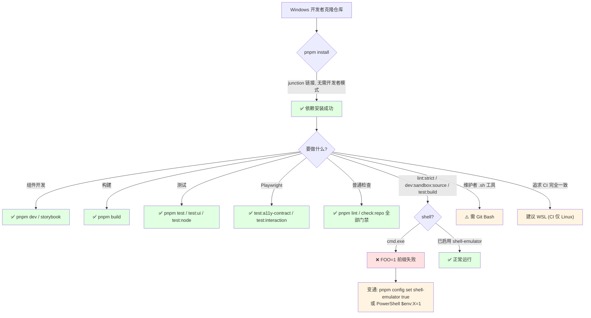

# Astryx - Windows 兼容性分析

> 生成时间: 2026-11-15 · 分析对象: D:\dev\git\z_jordon\fork\reading\astryx（main @ c87cb0c892）
> 数据来源: windows-compat-checker.sh 脚本扫描 + 源码深度核查（scripts/check-portable-scripts.mjs、check-executable-bits.mjs、.gitattributes、CI 工作流、关键脚本路径处理）

## 总体评估

| 指标 | 结果 |
|------|------|
| 总体评级 | ⚠️ 部分兼容（核心开发闭环原生可用，少量脚本需变通） |
| 高危问题 | 0 |
| 中危问题 | 2（涉及 4 个 package.json 脚本 + 8 个 bash 工具脚本） |
| 低危问题 | 3 |
| 已正确适配项 | 12+ |

### 评级说明

| 等级 | 含义 |
|------|------|
| ✅ 完全兼容 | 项目可在 Windows 上正常构建和运行 |
| ⚠️ 部分兼容 | 可构建但部分功能不可用，需少量修复 |
| ❌ 不兼容 | 无法在 Windows 上构建或核心功能不可用 |

**结论**：安装依赖、`pnpm dev`（Storybook）、`pnpm build`、`pnpm test`、typecheck、普通 `lint`、全部 `check:*` 门禁、Playwright 套件、changesets，以及发布出的 `astryx` CLI 本身，均可在原生 Windows（PowerShell/cmd）上运行。无法直接运行的是 3 个使用 `FOO=1 cmd` 内联环境变量前缀的根脚本（`lint:strict`、`dev:sandbox:source`、`test:build`）和 8 个 bash 工具脚本——前者是仓库**自知且自述**的缺口，后者主要是 CI/维护者工具。

## 1. 构建系统兼容性

### 1.1 package.json Scripts

**在 cmd.exe / PowerShell 下会失败的脚本**（pnpm 在 Windows 上默认用 cmd.exe 执行脚本；仓库无 `.npmrc`、无 `shell-emulator` 配置）：

| Script | 命令片段 | 问题 | 严重程度 |
|--------|------|------|----------|
| `lint:strict` | `ASTRYX_STRICT_LINT=1 eslint . --cache` | POSIX 内联环境变量前缀，cmd.exe 报 `'ASTRYX_STRICT_LINT' is not recognized` | 中 |
| `dev:sandbox:source` | `ASTRYX_SOURCE=1 pnpm -F @astryxdesign/sandbox dev` | 同上（普通 `dev:sandbox` 不受影响） | 中 |
| `test:build` | `ASTRYX_STYLEX_BROWSER=1 vitest …` / `ASTRYX_TURBOPACK_E2E=1 vitest …` | 同上 | 中 |

> 这是**已知且自述的缺口**：`scripts/check-portable-scripts.mjs:27-30` 头注释明确说明 cmd.exe 同样拒绝 `FOO=1 cmd` 写法，根目录这几个脚本在用，修复需要引入 `cross-env` 依赖，仓库选择了不引入。

**其余约 90 个脚本均 Windows 安全**：`node scripts/*.mjs`、`pnpm -F … run …`、`vitest`、`playwright test`、`changeset` —— `&&` 链在 cmd 中有效；`rm`/单引号等违规已被 `check:portable-scripts` 门禁阻止（该检查是 `check:repo` 和 `lint` 的一部分，防回归）。

### 1.2 生命周期 Hooks

| Hook | 命令 | 问题 | 严重程度 |
|------|------|------|----------|
| `prepare` | `node scripts/generate-i18n-runtime.mjs --best-effort && husky install` | 无问题。husky 9 在 Windows 上通过 Git for Windows 自带的 sh 正常工作 | ✅ |

### 1.3 构建工具链

| 工具 | Windows 支持 | 说明 |
|------|-------------|------|
| Node 24（`.nvmrc` = 24.22.1） | ✅ | nodejs.org 安装包路径已在 CONTRIBUTING.md 记载（nvm/Homebrew 路径是 macOS 优先的） |
| pnpm 11.10.0（`packageManager` 钉死） | ✅ | `npm install -g pnpm@11` 在 Windows 可用；Corepack 路径同样可行 |
| pnpm workspace 隔离链接器 | ✅ | Windows 上 pnpm 用 **junction** 链接 node_modules，无需开发者模式或管理员权限；仓库自带工具已按此预期编写（`internal/vibe-tests/setup-test/linkDirectory.mjs:62-93`） |
| esbuild / sharp / @parcel/watcher / puppeteer（`allowBuilds` 名单） | ✅ | 均提供 Windows 预编译产物（sharp 走预编译 libvips 二进制，无需本地编译） |
| Babel / StyleX / Vitest / Playwright / TypeScript | ✅ | 纯 JS 或官方支持 Windows；Playwright 唯一的 webServer（`apps/docsite/playwright.config.ts:64-65` 的 `pnpm exec next start`）在 Windows 上能正确解析 `.cmd` shim |

## 2. 源代码兼容性

### 2.1 child_process 调用

仓库脚本对子进程的调用普遍使用 `execFileSync` 并做了 Windows 路由，未发现裸 POSIX shell 依赖：

| 文件 | 处理方式 | 问题 |
|------|----------|------|
| `scripts/specs-for-file.mjs:787,953` | git 经 `execFileSync` 调用 | ✅ 无 |
| `internal/vibe-tests/setup-test/run-setup.mjs:79-95`、`src/fixture-suite.mjs:20-31` | pnpm 在 Windows 是 `.cmd` 批处理（裸 spawn 报 ENOENT，显式 `pnpm.cmd` 报 EINVAL），统一经 `cmd.exe /d /s /c pnpm …` 路由，规避 Node DEP0190 | ✅ 已适配 |
| `scripts/generate-i18n-runtime.mjs:203-221` | `createSpawnInvocation` 在 win32 下经 `ComSpec ?? 'cmd.exe'` 路由并带元字符白名单；单元测试含 win32 用例（`generate-i18n-runtime.test.mjs:179-195`），唯一的 POSIX 专属用例标注 `it.skipIf(win32)` | ✅ 已适配 |

### 2.2 平台相关代码

| 文件 | 行号 | 问题类型 | 说明 |
|------|------|----------|------|
| `internal/vibe-tests/setup-test/linkDirectory.mjs` | 62-93 | 目录链接 | win32 下用 junction/file 重建链接（Windows 无需提权即可创建 junction 的唯一链接类型），附完整注释 |
| `.github/scripts/cli-global-mode-smoke.mjs` | 369, 418-423, 910-914 | CLI 产品运行时 | Windows npm 全局 bin 目录、`AppData\Roaming\astryx` 配置、`AppData\Local\astryx\Cache` 缓存、taskkill 进程树清理，均有专用分支并在 windows-latest 上实测 |

全仓库无 cross-env / shelljs / shx / del-cli / rimraf（根依赖）等兼容层依赖——端口性靠"全部用 node 脚本 + 门禁检查"保证，而非依赖垫片。

### 2.3 Unix 专用 API

未发现无守卫的 Unix 专用 API 调用（无裸 symlink/unistd 依赖）；git 索引中**没有任何符号链接条目**（无 mode-120000 行），因此 Windows 默认 `core.symlinks=false` 的克隆不丢失任何内容。

## 3. 文件系统兼容性

### 3.1 路径处理

| 检查项 | 文件 | 结论 |
|--------|------|------|
| 路径拼接 | `scripts/generate-cli-themes.mjs`、`scripts/pre-review.mjs`、`scripts/specs-for-file.mjs` | 全部 `path.resolve`/`path.join`，无硬编码 `/` |
| git 风格路径归一 | `scripts/specs-for-file.mjs:72-74` | 自带 `toPosix()` 归一器（按 `path.sep` 切分），并用 `path.posix.basename/dirname` 处理 git 风格路径 |
| 行尾策略 | `.gitattributes:8` | `* text=auto eol=lf` 强制所有平台工作区 LF，覆盖 Windows 客户端的 `core.autocrlf=true`——注释（:1-7）明确记录它防止的故障：`generate-cldr-weekdays --check` 在 CRLF 检出上必然字节比对失败 |

### 3.2 符号链接

| 项 | Windows 处理 | 说明 |
|------|-------------|------|
| 仓库内 git 符号链接 | 无 | 索引零符号链接条目，默认克隆即可 |
| pnpm workspace 链接 | junction | 无需开发者模式/管理员 |
| CLI 全局模式 agent-skill 链接 | junction + 复制回退 | `docs/specs/AST-081-global-mode/spec.md:466` 设计为"Windows 上用 junction"，链接失败时降级为受管复制；由 windows-latest 冒烟作业验证 |
| `.claude-plugin/marketplace.json`、`plugins/astryx/**` | 常规文件 | 非符号链接 |

## 4. Shell 和脚本兼容性

### 4.1 Shell 脚本

脚本扫描发现的 8 个 `.sh` 文件**均未被任何 package.json 脚本引用**（全仓库 package.json grep bash/sh/.sh 零命中），按用途分：

| .sh 文件 | 用途 | Windows 说明 |
|----------|------|------|
| `.github/scripts/run-named.sh`、`merge-base.sh`、`native-swift.sh`、`typecheck-predating-head.sh`、`stale-head-hint.sh` | 仅 CI（ubuntu/macos runner）调用 | 开发者无需运行；需本地复现时用 Git Bash |
| `scripts/add-copyright.sh` | 维护者工具（CI 以 `--check` 运行）；使用 `find` + bash 数组 | 仅 Git Bash 可运行 |
| `scripts/prune-branches.sh` | 定时清理；自述"Works on macOS (zsh default) and Linux"（:12），明确不承诺 Windows | 维护者工具，Git Bash/WSL |
| `internal/vibe-tests/scripts/smoke-test.sh` | vibe-test 基建 PR 合并前自检 | 需 bash（Git Bash 可用） |

### 4.2 环境变量

| 变量 | 出现位置 | 问题 |
|------|----------|------|
| `ASTRYX_STRICT_LINT=1` | 根 `lint:strict` | cmd.exe 失败；PowerShell 变通见 §8 |
| `ASTRYX_SOURCE=1` | 根 `dev:sandbox:source` | 同上 |
| `ASTRYX_STYLEX_BROWSER=1`、`ASTRYX_TURBOPACK_E2E=1` | 根 `test:build` | 同上 |

其余环境变量（`ASTRYX_VISUAL_GATE_READ_ONLY` 等由 vitest 配置/Node 脚本内部设置）不受影响。

## 5. 测试和 CI/CD 兼容性

### 5.1 CI 配置

| 工作流 | Runner | Windows 支持 | 说明 |
|--------|--------|-------------|------|
| `ci.yml`（PR 主流程：test-ui/test-node/build/typecheck/pr-visual/pr-a11y 等） | ubuntu-slim / ubuntu-latest | ❌ 仅 Linux | **开发闭环无 Windows CI 覆盖** |
| `cli-global-mode-smoke.yml` | 矩阵 `[macos-latest, windows-latest, ubuntu-latest]` | ✅ 含 Windows | 唯一含 Windows 的作业，但仅 `workflow_dispatch` 手动触发，"It never runs on pull requests"（:8）。它证明**发布的 CLI 产品**在 Windows 可用：cmd.exe shell 路由（:282-288, 716-723，甚至显式测 `cmd.exe /d /s /c`）、全局 bin、AppData 路径、junction、taskkill |
| 其余 22 个工作流（release、perf-nightly、crowdin、pages-deploy 等） | ubuntu / ubuntu-arm | ❌ 仅 Linux/macOS | 与本地开发无关 |

### 5.2 测试覆盖

| 测试类型 | Windows 本地可跑 | 说明 |
|----------|-----------------|------|
| Vitest ui/node/perf（`pnpm test`） | ✅ | jsdom + StyleX babel 均纯 JS |
| Playwright a11y 契约（chromium + webkit） | ✅ | 需 `pnpm storybook:build` + `npx playwright install`；webkit 在 Windows 用 Playwright 官方构建 |
| 交互/storyboard（手机档 chromium + webkit） | ✅ | 同上 |
| `guard:*` 系列浏览器审计 | ✅ | 同为 Playwright |
| `test:build`（packed-consumer / turbopack e2e） | ⚠️ | 命令内环境变量前缀在 cmd 失败，变通后可跑 |

## 6. 依赖兼容性

### 6.1 原生模块

| 依赖 | 是否需要编译 | Windows 支持 |
|------|-------------|-------------|
| esbuild | 否（预编译二进制） | ✅ |
| sharp | 否（预编译 libvips） | ✅ |
| @parcel/watcher | 否（预编译） | ✅ |
| puppeteer | 安装时下载 Chrome | ✅ |
| @swc/core、core-js | 预编译/纯 JS | ✅ |

（以上均在 `pnpm-workspace.yaml` 的 `allowBuilds` 白名单中。）

### 6.2 可疑依赖

无。未使用 node-gyp 本地编译依赖；`minimumReleaseAge: 10080`（7 天发布冷却）进一步降低撞上新版破坏的风险。

## 7. 已正确处理的适配

| 适配项 | 文件 | 处理方式 |
|--------|------|----------|
| package.json 脚本端口性门禁 | `scripts/check-portable-scripts.mjs` | 三条规则：禁 POSIX 二进制（rm/cp/mv/mkdir -p/touch/cat/ln -s）；禁单引号参数（cmd 透传引号导致 glob 匹配为零并**静默空构建**）；rimraf 必须显式声明。可导入单元测试（`findOffences`） |
| 可执行位检查读 git 索引 | `scripts/check-executable-bits.mjs:23-44` | 用 `git ls-files -s` 校验索引 mode 100755（CI 检出得到的内容），与本地文件系统无关，Windows 上行为一致；修复提示直接给出 Windows 路径 `git update-index --chmod=+x` |
| 强制 LF 行尾 | `.gitattributes` | `* text=auto eol=lf`，防止 CRLF 检出破坏字节级 `--check` 比对 |
| 路径全用 node:path | `scripts/specs-for-file.mjs` 等全部 dev 脚本 | `path.resolve/join` + `toPosix()` 归一器，无硬编码分隔符 |
| junction 链接策略 | `internal/vibe-tests/setup-test/linkDirectory.mjs:62-93` | win32 下重建为 junction/file 类型链接 |
| pnpm `.cmd` shim 陷阱 | `internal/vibe-tests/setup-test/run-setup.mjs:79-95` | win32 统一经 `cmd.exe /d /s /c` 调用 pnpm，规避 ENOENT/EINVAL/DEP0190 |
| 子进程 ComSpec 路由 | `scripts/generate-i18n-runtime.mjs:203-221` | win32 用 `ComSpec ?? 'cmd.exe'` + 元字符白名单，含 win32 单测 |
| CLI 产品 Windows 运行时 | `packages/cli`（AST-081 规格） | junction 链接 + 复制回退、AppData 配置/缓存、taskkill 清理，windows-latest 实测 |
| Node 脚本替代 shell | 约 90 个根脚本 | 全部 `node scripts/*.mjs`，从根上消除 shell 差异 |
| 无符号链接检出依赖 | git 索引 | 零 mode-120000 条目，默认克隆设置即可 |

## 8. 修复建议

### 8.1 必须修复 (HIGH)

无——没有问题会阻断 Windows 上的安装、构建、测试或组件开发闭环。

### 8.2 建议修复 (MEDIUM)

1. **环境变量前缀脚本（`lint:strict` / `dev:sandbox:source` / `test:build`）**，三选一：
   - 开发者侧（零改动）：`pnpm config set shell-emulator true` 写入用户 `.npmrc`，让 pnpm 用内置 shell 模拟器执行脚本，`FOO=1 cmd` 即可工作；
   - 开发者侧（临时）：PowerShell 手工设值再执行等效命令，如 `$env:ASTRYX_STRICT_LINT='1'; pnpm exec eslint . --cache`；
   - 仓库侧（一劳永逸）：引入 `cross-env` 重写这三个脚本——仓库目前明确选择不引入（`check-portable-scripts.mjs:27-30`），如你常在 Windows 上贡献，可在 issue 中援引本报告推动。
2. **bash 工具脚本**：需要运行 `add-copyright.sh`、`prune-branches.sh`、`smoke-test.sh` 的维护者，安装 Git for Windows 后在 Git Bash 中执行即可；无需改动脚本本身。

### 8.3 可选改进 (LOW)

1. **CONTRIBUTING.md 增补 Windows 路径**：目前 1100+ 行中唯一提及 Windows 的是刷新快捷键（:1085）；建议补一节"Windows 开发者"（shell 选择、eol=lf 说明、上述三个脚本的变通），`docs/contributing/*.md` 同样无平台说明。
2. **开发闭环 CI 覆盖**：可考虑在 `ci.yml` 加一条可选的 windows-latest 冒烟（install + build + test:node 子集），防止端口性回归只靠静态检查兜底。
3. **Corepack 提示**：Node 25+ 不再捆绑 Corepack 的提示已写明，Windows 新手按 CONTRIBUTING 的 nodejs.org 安装包 + `npm i -g pnpm@11` 路径即可，可把这条路径标注为"Windows 适用"。

## 9. 兼容性流程图

### 一句话总结

Astryx 对 Windows 的友好度**高于绝大多数同规模 monorepo**：它把"可移植性"做成了机器检查（`check:portable-scripts` 三规则 + `check-executable-bits` 读索引 + `eol=lf` 强制），CLI 产品本身有 windows-latest 实测；代价是 3 个环境变量前缀脚本在 cmd.exe 上需要一行配置变通，维护者工具链（8 个 .sh）依赖 Git Bash，且贡献文档以 macOS/bash 为第一视角。
