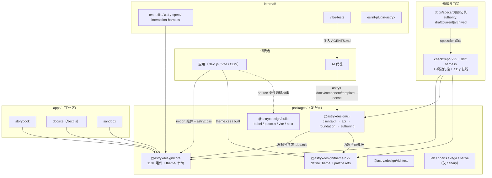
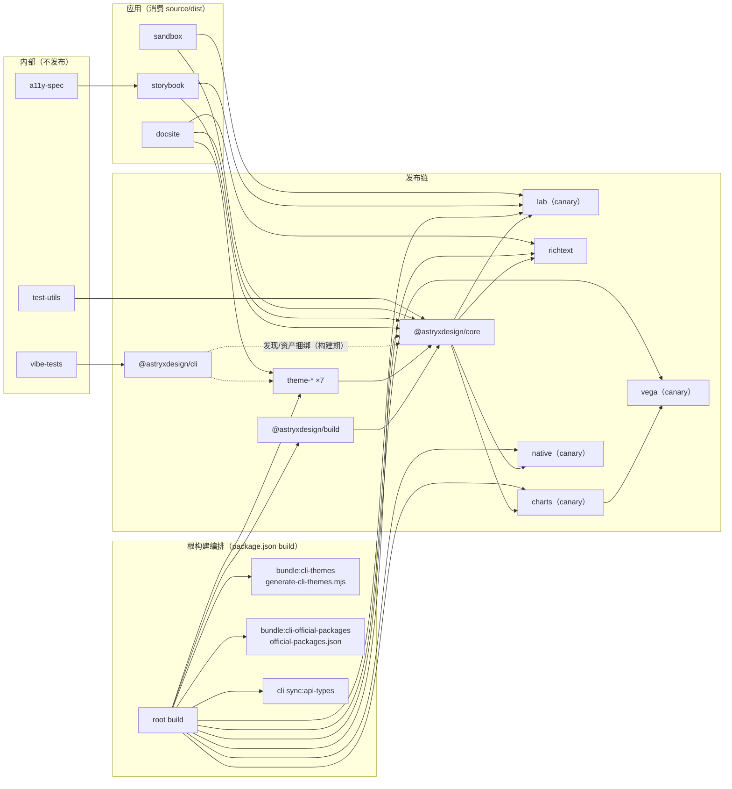

# Astryx - 架构分析

> 生成时间: 2026-11-15 · 分析对象: D:\dev\git\z_jordon\fork\reading\astryx（main @ c87cb0c892）
> 数据来源: project-info.sh / structure-analyzer.sh / dependency-scanner.sh 脚本扫描 + 4 路源码深度核查（CLI、core、构建/测试、Windows 兼容）

## 1. 项目概览

### 1.1 项目信息

| 项目 | 内容 |
|------|------|
| 名称 | Astryx（`astryx` / npm scope `@astryxdesign/*`） |
| 维护方 | Meta Platforms 开源（MIT，Beta 阶段） |
| 语言 | TypeScript（2504 个 .ts/.tsx）+ JavaScript（94 个 .mjs）+ 少量 Python（字体工具） |
| 类型 | 设计系统 monorepo（React 组件库 + CLI + 主题 + 构建插件 + 文档站） |
| 描述 | 开源设计系统：150+ 可访问组件、品牌级主题、暗色模式、页面模板、CLI，"人与 AI 代理共用同一套工具链" |
| 技术栈 | React 19+ · StyleX 0.19.1 · TypeScript 严格模式 · pnpm 11.10.0 · Node 24（`.nvmrc` = 24.22.1） · Vitest 4 · Playwright · Changesets |
| 规模 | 7911 commits · ~110 个 core 组件（124 目录，115 个子路径导出）+ 31 个 lab 组件 · 8 主题包 · 2500+ TS 文件 |
| 版本 | 发布组 0.7.x（fixed group，11 个稳定包同版本） |

### 1.2 目录结构

```
astryx/
├── apps/                      # 工作区应用（workspace 成员）
│   ├── storybook/             #   组件游乐场（localhost:6006，直接编译各包 src/）
│   ├── docsite/               #   文档站（Next.js → astryx.atmeta.com）
│   ├── sandbox/               #   开发测试场 / 性能场景宿主
│   ├── template-viewer/       #   模板预览器
│   ├── example-*/             #   7 个独立示例应用（不在 workspace 内，自带锁文件）
├── packages/                  # 发布包
│   ├── core/                  #   ⭐ 组件库本体（124 src 目录，177 个导出子路径）
│   ├── cli/                   #   ⭐ astryx CLI（clients/api/foundation/authoring 四层）
│   ├── build/                 #   @astryxdesign/build（babel/postcss/vite/next 源码构建插件）
│   ├── lab/                   #   实验组件（仅 canary 发布）
│   ├── charts/ vega/          #   图表（d3 配置模型 / Vega 包装，仅 canary）
│   ├── richtext/              #   Lexical 富文本（稳定发布）
│   ├── native/                #   原生平台实验（iOS/Android/macOS/Windows，仅 canary）
│   └── themes/                #   8 个主题包：neutral/butter/chocolate/matcha/stone/gothic/y2k（+probe 测试夹具）
├── internal/                  # 内部工具（不发布）
│   ├── test-utils/ a11y-spec/ interaction-harness/   # 测试基建
│   ├── eslint-plugin-astryx/  #   自定义 lint 规则（no-internal-barrel-import 等）
│   ├── vibe-tests/            #   AGENTS.md 有效性评测（21 条提示词 + 降级曲线）
│   ├── shadcn-registry/ stylex-capabilities/ lab-readiness/
├── docs/                      # 维护者知识库（specs/components/、architecture/、families/…）
├── scripts/                   # 根构建/门禁脚本（~40 个 .mjs/.js）
├── plugins/ .claude-plugin/   # Claude Code 插件（agent 技能）
└── .github/                   # 25 个工作流 + 视觉基线 + a11y 基线 + PR 模板
```

## 2. 架构设计

### 2.1 架构模式

**pnpm catalog 驱动的 monorepo + 多层"契约先行"架构**。识别到五个关键模式：

1. **严格分层 monorepo**：`apps/`（应用）→ `packages/`（发布物）→ `internal/`（内部工具），包间依赖由 `scripts/check-package-boundaries.js` 静态扫描 import 强制（如 core 与 native 完全隔离）。
2. **CLI 四层架构**（`packages/cli/`，ESLint `no-restricted-imports` + `check:cli-structure` 双重强制）：
   - `authoring/`（纯数据类型 + zod 封装解析器，零依赖其他层）
   - `foundation/`（跨切基础设施：JSON 契约、错误码、发现层、路径安全；禁止 import api/clients）
   - `api/`（`@astryxdesign/cli/api`，每命令一目录，返回 `{type, data}` 信封；禁止 import clients/、禁止访问环境[INV21]）
   - `clients/cli/`（Commander 12 程序 + 薄命令处理器：解析 flags → 调 api → 渲染；禁止访问环境[INV22]）
3. **双通道样式分发**：core 同时提供预编译产物（`dist/astryx.css` + Babel 编译 JS）和 `source` 导出条件（让消费方 bundler 经 `@astryxdesign/build` 从源码编译 StyleX）——消费者**无需任何构建插件**即可用，进阶用户又可深度定制。
4. **文档即数据（Docs-as-data）**：所有可发现物（组件 `ComponentDoc`、命令 `CommandDoc`、API `FunctionDoc`、长文 `ReferenceDoc`、词汇表 `EnumDoc`）都是同源 `.doc.mjs` 类型化对象，经 `parseDoc` zod 校验 + 漂移测试（`packages/cli/test/drift/`）保证与真实 CLI 一致；同一对象供给 CLI、搜索、manifest 和 docsite。
5. **知识记录系统**（`docs/specs/`）：带 `authority: draft|current|archived` 声明、版本化 schema、`pnpm specs:for <path>` 路径路由、"评审回执"——把架构决策本身做成可机检的工件。

### 2.2 核心模块

| 模块 | 职责 | 关键文件 |
|------|------|----------|
| `packages/core/src/theme/` | 令牌系统：14 组 `*Vars`/`*Defaults` 成对导出（`stylex.defineVars`）；`defineTheme` 作者 API；`Theme.tsx` Provider；`generateThemeRules` 降级为 CSS | `tokens.stylex.ts:177-479`、`defineTheme.ts`、`Theme.tsx`、`themeRegistry.ts` |
| `packages/core/src/<Component>/` | 组件标准解剖：实现 + `.doc.mjs` + `index.ts`（含可扩展 `*VariantMap` 接口）+ 同目录测试 | `Button/Button.tsx`（~1200 行，样式内联 `stylex.create`） |
| `packages/cli/clients/cli/` | 入口与分发：Node 版本门禁 → 发布交接 → 惰性加载单命令 → Commander 解析 | `bin/astryx.mjs`（99 行）、`run.mjs`、`index.mjs:338-366` |
| `packages/cli/foundation/discovery/` | 发现层：组件/文档/主题三源（bundled 资产 + node_modules Core + 集成包），记忆化 + 跨运行缓存 | `component-discovery.mjs:43-79`、`theme-discovery.mjs`、`docs-discovery.mjs` |
| `packages/build/src/` | 源码构建插件：双 StyleX 实例按文件分发（库前缀 `astryx` / 产品前缀 `x`），输出层级 `reset < astryx-base < astryx-theme < product` | `babel.js`、`postcss`(`index.js`)、`vite.ts`、`next.js`、`source-stylesheet.js` |
| 主题包 ×8 | `palette.config.json` → 生成全量色板 → `*-PaletteRefs.generated.ts`（运行时精简子集，`--check` 防漂移）→ `defineTheme` | `packages/themes/neutral/src/neutralTheme.ts` |
| `scripts/`（根） | ~25 项 `check:repo` 门禁 + 构建编排 + 发布脚本 | `build-css.mjs`、`check-portable-scripts.mjs`、`release/version-packages.mjs` |
| `internal/vibe-tests/` | AGENTS.md 有效性回归（21 提示词 × 单发/10 轮降级） | `internal/vibe-tests/` |

### 2.3 架构图



## 3. 依赖关系分析

### 3.1 外部依赖（关键项）

| 依赖 | 版本 | 用途 |
|------|------|------|
| `@stylexjs/stylex` | ^0.19.1（catalog 钉死） | 全部样式作者面；AGENTS.md 内嵌其能力矩阵 |
| `react` / `react-dom` | ^19.3（peer ≥19） | 组件运行时；ref 即 prop，无 forwardRef |
| `commander` | 12.x | CLI 命令框架（其短路行为被 `lib/json-shim.mjs` 补丁以遵守 JSON 契约） |
| `zod` | — | authoring 层文档解析器（密封不外泄） |
| `@stylexjs/babel-plugin` | ^0.19.1（catalog） | core 构建与 build 包共用；`propertyValidationMode:'throw'` 失败即断 |
| `vitest` / `@playwright/test` | 4.x / 1.61 | 三项目单测 + 三套浏览器契约 |
| `intl-messageformat` | — | core 运行时 i18n（ICU 消息） |
| `lexical` | — | richtext 编辑器内核 |
| `d3` / `vega` | — | charts / vega 数据可视化 |
| `jscodeshift` + `recast` + `babel` 工具链 | — | CLI codemods（`astryx upgrade`） |
| `lucide-react` | — | neutral 主题图标集 |
| `cldr-core` 等 | 48.x | 生成 Calendar 星期缩写（CLDR 数据） |

> **供应链策略**（`pnpm-workspace.yaml`）：`minimumReleaseAge: 10080`（npm 发布冷却 7 天）；`catalog:` 统一钉 vite/stylex/babel/prettier/esbuild 版本；`overrides` 存放 5 条带注释的**活性安全底线**（postcss/dompurify/esbuild/js-yaml/sharp，各注明删除条件）。`allowBuilds` 白名单仅 6 个原生依赖，全部有 Windows 预编译产物。

### 3.2 模块依赖图



**层内规则**（机器强制）：
- 包内 import 必须指向定义模块（`'../List/List'`），禁止 index 桶（`@astryxdesign/no-internal-barrel-import` + `check-component-import-boundaries.mjs`）——保 `source` 条件可摇树、避免环。
- core 禁 import 包特定 API；core ↔ native 完全隔离（`check-package-boundaries.js`）。
- CLI：`api/` 不进 `clients/`，`foundation/` 不进 `api/`、`clients/`（ESLint + `check:cli-structure`）。

### 3.3 依赖健康度

| 类别 | 数量 | 说明 |
|------|------|------|
| 根 devDependencies | 42 | 全部开发期；无运行时依赖（root 是 private 0.0.0） |
| core 运行时依赖 | 1（`intl-messageformat`）+ 3 peer | 对消费者极轻 |
| cli 运行时依赖 | ~15（commander/zod/jiti/babel/jscodeshift/css-tree/postcss/linkedom/node-diff3 等） | 无原生编译依赖 |
| 过时依赖 | 0 已知 | catalog 集中钉版 + Dependabot（pnpm-workspace.yaml 注释记录了 Babel 8 迁移等待决策） |
| 安全底线 | 5 条 overrides | 每条注释标明"依赖者 + 删除条件"，可 `pnpm install --lockfile-only && pnpm audit` 复验 |

## 4. 质量与知识治理（本仓库特有层）

| 机制 | 位置 | 作用 |
|------|------|------|
| 知识记录 | `docs/specs/`（组件契约 `specs/components/<Name>/`、系统规格 AST-NNN、架构 ADR） | `authority` 三态；只有 `current` 治理实现与评审；`pnpm specs:for <path>` 按路径路由 |
| `check:repo` 门禁 | `scripts/`（~25 项） | 端口性、可执行位、包边界、i18n 目录、CLDR、令牌文档、变更集… |
| 漂移测试 | `packages/cli/test/drift/` | `CommandDoc`/`EnumDoc` 必须与真实 CLI 逐字段一致 |
| 视觉门控 | `.github/scripts/visual-gate/gate.mjs` | 基线晋升必须走 `accept` + PR 评审；`flaky` 用 N 次哈希对比生成排除清单 |
| a11y 体系 | axe 基线（只减不增）+ WAI-ARIA 契约测试（jsdom/Chromium 双泳道）+ RTL 审计 + 4 个 `guard:*` 浏览器探针 | 可访问性是硬门禁 |
| vibe-tests | `internal/vibe-tests/` | 用 21 个提示词回归"AGENTS.md 能否让 LLM 写出正确组件代码" |
| 发布 | Changesets fixed group（11 稳定包）+ `version-packages.mjs` 钉版消费 + canary 小时级发布 + Blog 评审量表 | 0.x 语义由 changeset 类别驱动 |

## 5. 总结

Astryx 的架构优势在于**把"约定"全部下沉为"机器检查"**：CLI 的四层边界、组件的导入规则、文档与实现的漂移、样式层叠顺序、a11y 基线、甚至贡献指南对 LLM 的有效性，都有对应的自动门禁。对使用者的直接收益是：预编译 CSS 让接入零构建配置（`@layer` 三层级联保证与 Tailwind 共存），`source` 导出条件 + `@astryxdesign/build` 又给深度用户保留 StyleX 源码级定制能力；对 AI 代理的收益是：单一 `.doc.mjs` 数据源经 CLI 以 `--dense`/`--json` 形式输出，令牌效率与人类可读性兼得。
