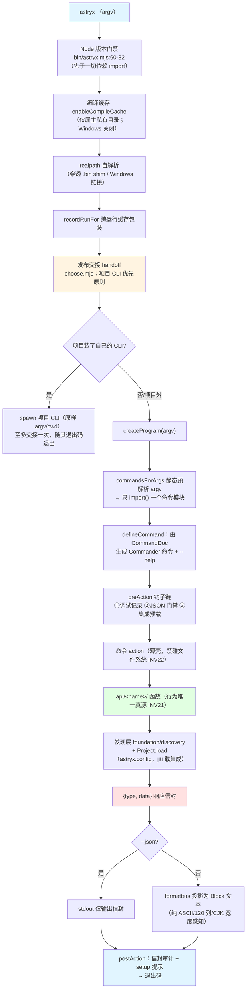
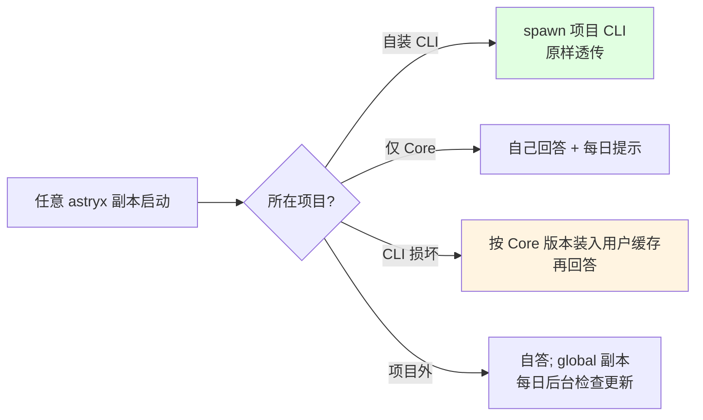
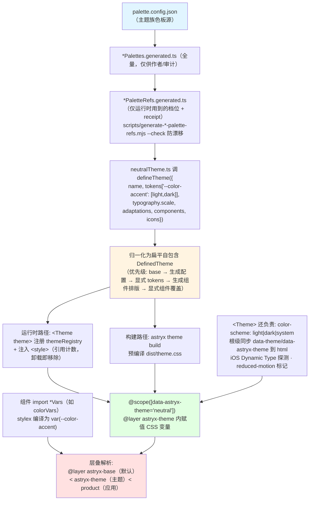
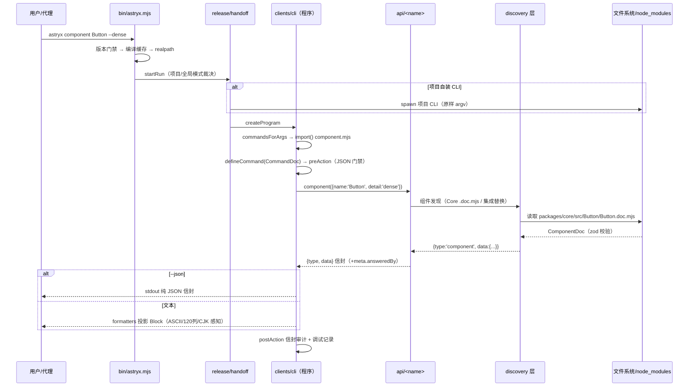
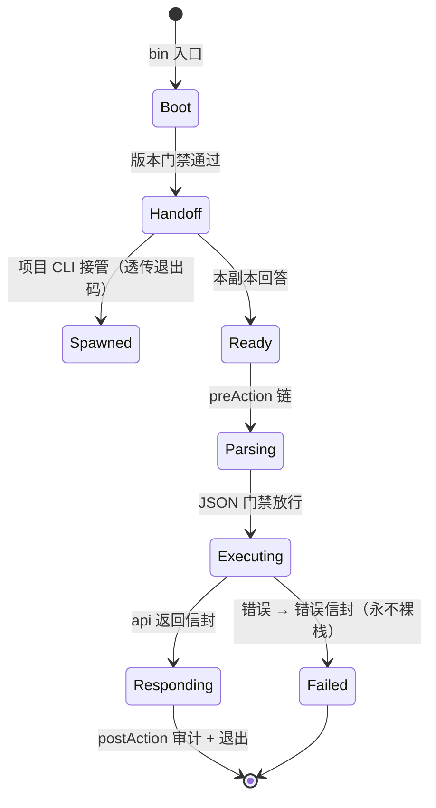
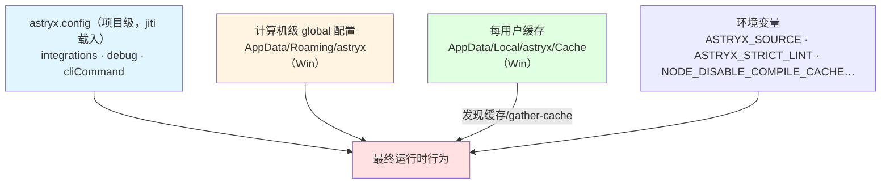
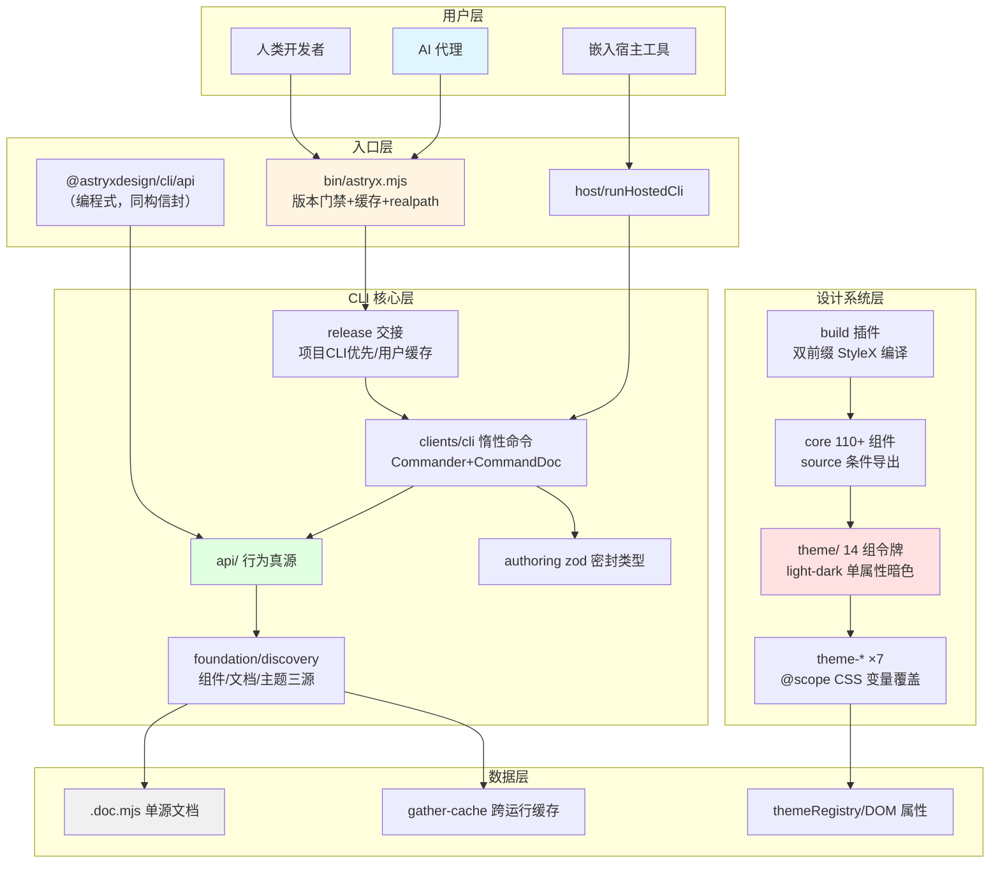

# Astryx - 运行机制详解

> 生成时间: 2026-11-15 · 分析对象: D:\dev\git\z_jordon\fork\reading\astryx（main @ c87cb0c892）
> 重点：CLI 启动与命令分发、主题系统运行时、StyleX 双通道编译、构建管线、测试执行、扩展机制

## 一、项目运行方式

Astryx 有两个运行视角：**消费者**（npm 安装组件库与 CLI）与**贡献者**（克隆 monorepo 开发）。核心运行机制集中在 CLI（`packages/cli`）与主题系统（`packages/core/src/theme/`）。

### 1. 安装与执行

```bash
# 消费者：安装组件库 + 主题 + CLI
npm install @astryxdesign/core @astryxdesign/theme-neutral @stylexjs/stylex
npm install -D @astryxdesign/cli
npx @astryxdesign/cli init                 # 把组件索引写入 AGENTS.md/CLAUDE.md
npx @astryxdesign/cli component Button     # 查询任意组件文档

# 全局安装（任一目录可用 astryx；项目内自动让位给项目自己的 CLI）
npm i -g @astryxdesign/cli

# 贡献者：克隆 monorepo
pnpm install && pnpm dev        # Storybook localhost:6006（直接编译 src/，无需先 build）
```

### 2. CLI 执行流程（单次运行全景）



## 二、核心运行机制

### 2.1 CLI 启动：三道防线与惰性加载

**位置**: `packages/cli/clients/cli/bin/astryx.mjs`（99 行）、`run.mjs`、`index.mjs`

**说明**: 入口极小，按序做四件事——版本门禁（`foundation/env/node-version.mjs` 零依赖，因 `node:util.styleText` 需 Node ≥22.13）、编译缓存（`tmpdir()` 属主校验，Windows 无 uid 检查故禁用）、realpath 自解析、发布交接。然后 `run.mjs` 装上 `unhandledRejection`/`uncaughtException` 边界（JSON 模式永远拿到信封而非堆栈），进入程序构建。

**机制作用**：

- **失败隔离**：`index.mjs:943-966` —— 惰性加载的命令模块若加载失败，替换为打印 "failed to load" 的桩命令，其余命令照常工作。
- **惰性一切**：一次运行只加载一个命令模块（help/manifest/未知词才全量）；发布版的根帮助读 prepack 生成的 `commands.generated.json`（`index.mjs:455`），不触碰任何命令模块。
- **JSON 即契约**：`--json` 是真源、文本是投影。`JSON_SUPPORTED` 白名单（`index.mjs:96-156`）在副作用发生**前**拒绝不支持的命令；`lib/json-shim.mjs` 给 Commander 的 `--help`/解析错误短路打补丁，使其同样遵守信封；`postAction` 兜底审计忘带信封的命令。
- **未知命令**：Levenshtein 距离 ≤3 的建议，错误码 `ERR_UNKNOWN_COMMAND`。

### 2.2 发布交接（project vs global 模式）

**位置**: `packages/cli/foundation/release/{handoff,choose,cache,global-state}.mjs`（规格 AST-081）

**说明**: 策略四分支（`choose.mjs:4-31`）：(a) 项目自装 CLI → 该 CLI 回答一切，其他副本以相同 argv/cwd spawn 它并透传退出码（至多交接一次）；(b) 项目只有 Core → 起始副本回答，附每日一次的"建议安装 CLI"提示；(c) 项目 CLI 损坏 → 按项目 Core 版本按需装入**每用户发布缓存**（`userCacheDir`）后回答；(d) 项目外 → 每个副本自答；计算机级（global）副本启动每日一次的后台更新检查但**绝不自动安装**。文本模式在 stderr 打一行 "answered by CLI x.y.z with Core a.b.c"；`--json` 放在 `meta.answeredBy`。



**机制作用**：全局与项目安装可安全共存（README 明确推荐 both）；Windows 专项设计（junction 链接、AppData 路径、taskkill 清理）由 `cli-global-mode-smoke.yml` 在 windows-latest 实测。

### 2.3 主题系统运行时：令牌 → CSS 自定义属性 → @scope 主题

**位置**: `packages/core/src/theme/`（`tokens.stylex.ts`、`defineTheme.ts`、`generateThemeRules.ts`、`Theme.tsx`、`themeRegistry.ts`、`useTheme.ts`）

**说明**: 全部令牌在 `tokens.stylex.ts` 中成对声明——`*Defaults`（纯 CSS 默认值对象）+ `*Vars`（`stylex.defineVars`），共 14 组（color/spacing/size/border/focus/radius/shadow/duration/ease/typography/textSize/fontWeight/typeScale + data/syntax 域令牌）。默认值大量使用 CSS `light-dark()`，**暗色模式 = 每令牌一个自定义属性**，由 `color-scheme` 决定取哪半边（无需第二份样式表）。

数据流：



**机制作用**：

- **主题不改组件代码**：组件级覆盖目标是稳定类名（`naming.ts` 的 `.astryx-button`）+ `utils/themeProps.ts` 反射的 `data-variant` 等 `data-*` 属性。
- **`@scope` 而非后代选择器**：主题 CSS 能穿透 React portal（弹层挂在 body 也被覆盖）。
- **JS 侧同源解析**：`useTheme` 同步读令牌值（mode 恒解析为 light/dark），供 canvas/图表用；无 Provider 时回退监听 `<html>` 属性（共享 MutationObserver）。
- **每实例逃生门**：`xstyle` prop（StyleX 样式，最后合并、逐属性 last-wins，见 `Button.tsx:1007-1010` 注释）、或直接在任何元素上设置 CSS 变量。

### 2.4 StyleX 双通道编译

**位置**: `scripts/build-css.mjs`（根）、`packages/build/src/{babel.js,index.js,vite.ts,next.js,source-stylesheet.js}`、`packages/core/babel.config.json`

**说明**: 同一份源码 `*.stylex.ts` + 组件内联样式，走两条等价通道：

| 通道 | 路径 | 产物 | 适用 |
|------|------|------|------|
| **预编译**（默认） | core 构建时 Babel（`@stylexjs/babel-plugin`，dev:false、runtimeInjection:false、`propertyValidationMode:'throw'`）剥离 StyleX 为原子类调用；`build-css.mjs` 走同一 `source-stylesheet.js` 的模块图遍历另编出样式表 | `dist/**/*.js` + `dist/astryx.css`（整体包在 `@layer astryx-base`） | 消费者零构建配置：`import '@astryxdesign/core/astryx.css'` |
| **源码构建**（进阶） | 消费方 bundler 经 `exports` 的 `source` 条件（`"source": "./src/Dialog/index.ts"`）取源码，`@astryxdesign/build` 的 babel/postcss/vite/next 插件在消费方编译期处理 StyleX | 消费方自己的样式产物（Vite 插件的 `virtual:stylex.css` 与 dist 样式表逐字节一致） | Next.js（webpack/Turbopack）、Vite 深度集成；类名与预编译一致 |

**关键设计**（`packages/build/src/babel.js`）：**双 StyleX 插件实例按文件分发**——库文件（core/themes/lab/已 swizzle 源码）用前缀 `astryx`（`.astryx78zum5`），产品文件用前缀 `x`；层级严格 `reset < astryx-base < astryx-theme < product`，原子类跨层永不冲突（`guard:theme-layers` 浏览器审计守卫）。Next.js 集成显式编译 SOURCE_PACKAGES（core/theme-neutral/lab/charts/richtext）以保证 Turbopack 类名与预编译样式表一致。

### 2.5 测试执行机制

**位置**: `vitest.config.ts`、`vitest.{global-setup,setup}.node.mjs`、三个 `playwright.*.config.ts`

**说明**: Vitest 4 内联三项目：

- **ui**：继承根 jsdom + `@vitejs/plugin-react`（dev 模式注入 StyleX babel 插件 + 别名 `@astryxdesign/core` → `packages/core/src`）——**测试跑在源码上而非 dist**；jest-dom + 30s 超时。
- **perf**：仅 `Markdown.fr23.perf.test.ts` 一个基准文件，`sequence.groupOrder` 令其最后跑，`test:ui:isolated` 串行执行。
- **node**：**故意不继承根配置**（无 jsdom/StyleX 变换）；`server.deps.external` 让 CLI 的 `import-url.mjs` 等走原生加载。
- **全局搭台**（`vitest.global-setup.node.mjs`）：注册运行租约防并发、**只构建一次 core**（`ensureCoreBuiltForRun`，避免并行 clean-build 冲突）、重生成 sandbox 模板注册表、每用户状态重定向到临时 HOME（`XDG_CONFIG_HOME`/`APPDATA`）、CLI 只 `npm pack` 一次经 `project.provide('astryxPackedCliTarball')` 分发给 workers。
- **setup**（`vitest.setup.node.mjs`）：删掉继承的 `NODE_PATH` 并重跑 `Module._initPaths()`，使夹具项目只从自身目录解析依赖（模拟真实用户项目）。
- **分片**：`vitest-shard-sequencer.mjs` 按历史文件时长把 `--shard` 切腿，CI 动态选腿数。

Playwright 三套：a11y 契约（chromium+webkit 桌面，读已构建 Storybook，`@pr-a11y` 头部注释路由）、交互/storyboard（chromium+webkit，内联 iPhone 17 Pro 触屏档）、性能场景（夜间，趋势数据非门禁）。

### 2.6 视觉回归门控

**位置**: `.github/scripts/visual-gate/gate.mjs`（`pnpm visual:plan|check|flaky`）

**说明**: 从 Storybook 故事索引构建截图计划（tier：component/theme-matrix/probe；标签 `visual-baseline`/`visual-theme-matrix`/`no-visual`），PR 默认只拍触及组件（AST-030 FR12 不自动扩面）。退出码即契约：0 干净 / 1 崩溃 / **2 有变化（变化是问题不是失败）** / 3 需扩面。基线在 `.github/visual-baseline/`，**只能**经 `accept` 命令（复核判定+PNG 哈希+记录 actor/原因/runId）晋升且必须走 PR 评审——永不自动更新。`flaky` 同计划拍 N 遍、对比每张 sha256，哈希漂移者进入排除清单，杜绝误报。

## 三、完整工作流程

### 场景 1: AI 代理查询组件文档（token 高效路径）

```bash
astryx help                                  # 发现全部命令（读生成的命令清单，<500ms 引导）
astryx component --list                      # 按类别列出全部组件
astryx component Button --dense              # 单组件：props/变体/用法/解剖（中文: --zh）
astryx docs theme --dense                    # 长文档：主题 Provider、明暗、覆盖
astryx docs <topic> --index                  # 一节一行，带 key
astryx search 表单                            # 跨组件/钩子/文档/模板/主题的单一 ranked 列表
```

数据源：`assets/docs/*.doc.mjs`（~20 主题 + tree/ 子树）+ 各包 `{Name}.doc.mjs`；发现层零注册（目录即目录）；搜索目录 prepack 生成 + 跨运行缓存（内容/环境/模块态键控，build-id 戳）。

### 场景 2: 消费者定制主题

```bash
astryx theme eject my-theme        # 从 CLI 内置主题模板弹出完整主题工程（无需装主题包）
#   编辑 myTheme.ts：defineTheme({extends: neutral, tokens: {'--color-accent': '#...'}, ...})
astryx theme build src/myTheme.ts -o dist/theme.css    # 预编译为静态 CSS
astryx theme palette generate      # 从基准色生成整套色板档位
astryx doctor                      # 体检：node 版本/对齐/peer/配置/孤儿覆盖等 ~15 项检查
```

### 场景 3: 贡献者新增组件（完整闭环）

```bash
mkdir packages/core/src/MyComponent          # 1. MyComponent.tsx + .test.tsx + .doc.mjs + index.ts
#    （stories 不同目录：apps/storybook/stories/）
pnpm -F @astryxdesign/core test              # 2. 同目录测试
pnpm sync:exports:check                      # 3. exports 映射由 sync-exports.js 自动生成，禁手编
pnpm specs:for packages/core/src/MyComponent # 4. 查治理该路径的知识记录
pnpm lint:strict && pnpm test && pnpm build  # 5. 推送前机械门禁
pnpm changeset:new                           # 6. 交互式变更集（类别→semver；贡献者署名）
```

### 场景 4: 版本发布（维护者）

```bash
# main 上 release-check + 全量单测双绿后切 release/vX.Y.Z 分支
pnpm version-packages    # version-packages.mjs 钉版消费冻结的 changesets → changelog → 删卡片
                         # → promote-codemod-next → sync-internal-deps → format-changelogs
# tag + 发布（release.yml：稳定=手动 dispatch；canary=每小时自动 <declared>-canary.g<sha>）
```

### 完整工作流序列图（CLI 单命令生命周期）



## 四、数据流与状态管理

### 4.1 响应信封（一切命令的统一数据结构）

| 结构 | 用途 | 定义位置 |
|------|------|----------|
| 成功信封 `{apiVersion, type, package?, data, meta?}` | CLI `--json` 与 `@astryxdesign/cli/api` 导入函数**逐字节同构** | `foundation/response/json.mjs` |
| 错误信封 `{apiVersion, error, code, suggestions?}` | 稳定 `ERROR_CODES`（封闭词汇表，EnumDoc 镜像，删除/改名需 breaking changeset） | `foundation/response/error-codes.mjs` |
| `CommandDoc`/`FunctionDoc`/`ComponentDoc`… | 单源文档对象 → 帮助/manifest/搜索/docsite 四处消费 | `authoring/`（zod 密封） |
| `DefinedTheme` | 归一化扁平主题（优先级五层合并的产物） | `core/src/theme/defineTheme.ts` |
| `{type, data}` api 信封的 `.d.mts` 声明 | 从 `.mjs` JSDoc 生成（`sync-api-types.mjs`），gitignore、prepack 再生 | `packages/cli/scripts/sync-api-types.mjs` |

### 4.2 状态管理（CLI 侧）



**跨运行状态**：发现产物缓存（gather-cache，任何文件/环境/模块变化即失效，0700 私有目录，build-id 键控）；全局模式每日更新检查状态（`global-state.mjs`，只读检查不安装）；doctor 检查结果带 id，可被 CI 消费。

### 4.3 状态管理（组件侧）

无全局 store。主题态经 `themeRegistry`（按名查找）+ DOM 属性（`data-astryx-theme`、`color-scheme`）承载；跨根上下文用 `utils/sharedContext.ts` 的 `createSharedContext`（多 React 根安全）；焦点/键盘态由 `useListFocus`/`useGridFocus`/`useTreeFocus` 从容器 DOM 探测方向（RTL 自动翻转）。

## 五、扩展机制

### 5.1 插件/扩展系统

| 扩展点 | 机制 | 入口 |
|--------|------|------|
| **集成包（integration）** | 第三方包声明 `.doc.mjs` 同茎文档 + 配置，可贡献组件/主题/模板/文档/codemod 五类；CLI 的 `discover`/`component`（替换解析 `component-replacement.mjs`）原生识别 | `astryx integration add/check/verify/pack`；规格 AST-039 |
| **swizzle（源码弹出）** | 把组件完整源码复制进用户项目自由改造（构建插件自动识别已 swizzle 源码用 `astryx` 前缀编译） | `astryx swizzle Button` |
| **变体模块增强** | `Button/index.ts` 导出可扩展 `ButtonVariantMap` 接口，下游 `declare module '@astryxdesign/core/Button'` 加变体，零包装 | `packages/core/src/Button/index.ts` |
| **codemods** | jscodeshift 变换集，`upgrade --from <ver> --apply` 执行版本迁移；next 级 codemod 在发布时晋升 | `assets/codemods/` |
| **LinkProvider** | 交换内部链接组件以接 Next.js Router/React Router（`Button.tsx:900` 的 href/as 走 `useLinkComponent`） | `core/src/Link/LinkProvider.tsx` |
| **嵌入宿主** | `@astryxdesign/cli/host` 的 `runHostedCli({argv, cwd, cliCommand, integrations...})`——工具产品把 CLI 整体嵌入且保持进程所有权 | `packages/cli/host/index.mjs` |
| **主题 adaptations** | 按环境规则（pointer/width）覆盖令牌——如 neutral 主题触屏规则基字号 14→16px（`neutralTheme.ts:73-79`） | `defineTheme` 入参 |

### 5.2 钩子点

| 钩子 | 触发时机 | 用途 | 注册位置 |
|------|----------|------|----------|
| `preAction` ×3 | 每命令解析前 | 调试记录 → JSON 门禁 → 集成 `cliCommand` 预载 | `clients/cli/index.mjs` |
| `postAction` | 每命令后 | 信封兜底审计 + setup 每日提示 | `clients/cli/index.mjs` |
| `useTheme` | 渲染期 | JS 侧令牌解析（无 Provider 回退监听 html 属性） | `core/src/theme/useTheme.ts` |
| `useAnnounce`/`useFocusTrap`/焦点钩子 | 组件交互期 | 共享 WAI-ARIA 原语（手写等价物会被评审拒绝） | `core/src/hooks/` |
| `debug()` 处理器 | 项目 `astryx.config` 声明 | 接收 CLI 运行遥测 | `foundation/debug/` |

### 5.3 配置管理



仓库级还有：`pnpm-workspace.yaml`（catalog 钉版/overrides 安全底线）、`.nvmrc`（Node 版本唯一真源）、`visual-gate.config.json`（截图预算/排除清单）、`.github/a11y-baseline.json`（只减不增基线）。

## 六、运行时架构总结



## 总结

Astryx 的运行机制围绕六个核心概念：

1. **JSON 即契约**：`--json` 与编程 API 逐字节同构，文本输出只是投影；错误也是封闭词汇表的稳定信封——这是"人与代理同一工具链"的技术基石。
2. **项目 CLI 优先的发布交接**：全局/项目/用户缓存三种副本确定性裁决，交接至多一次。
3. **单源文档对象**：一个 `.doc.mjs` 喂饱帮助、manifest、搜索、docsite 四个消费面，漂移测试保证不撒谎。
4. **令牌即 CSS 变量**：`defineVars` 成对默认值 + `light-dark()` + `color-scheme`，暗色模式零额外样式表；主题是 `@scope` 的变量覆盖，永远不必 fork 组件。
5. **双通道 StyleX 分发**：预编译 CSS（零配置接入）与 source 条件源码构建（深度定制）共享同一模块图遍历器与层叠契约，字节级一致。
6. **门禁即架构**：层级规则、端口性、可执行位、a11y 基线、视觉基线全部由脚本门禁 + 浏览器守卫机器执行，架构文档（知识记录）本身也有 schema 和路由器。

这使 Astryx 既**对消费者近乎零成本接入**（三条 CSS import + 一个 Provider），又**对贡献者和 AI 代理高度可预测**（每个约定都有机器检查兜底），非常适合作为"设计系统 + AI 协作工程"的参考实现。
